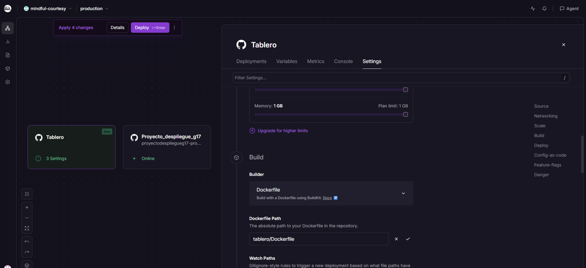
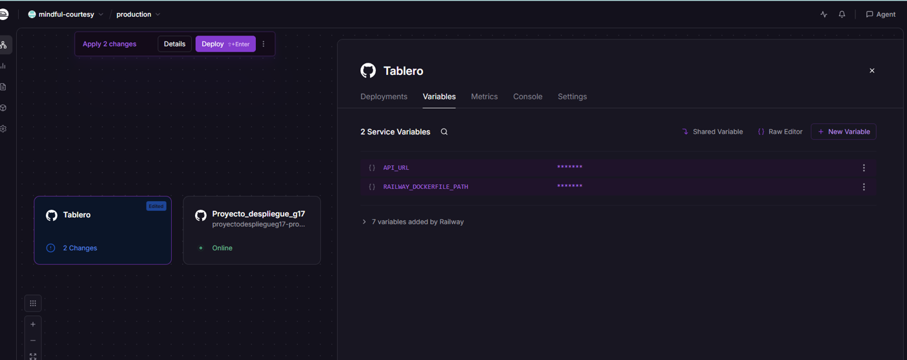
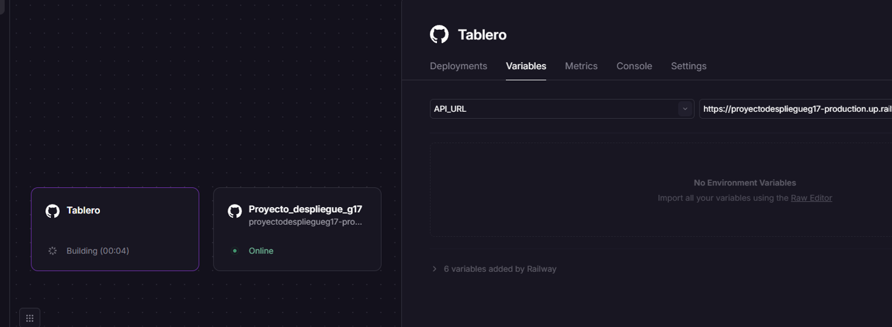
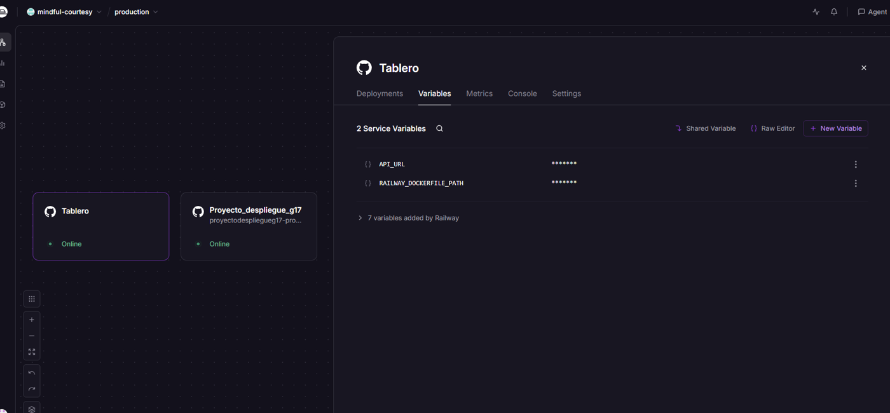

# Manual de instalación – UCI Analytics (API + tablero)

La solución tiene dos servicios, cada uno con su Dockerfile:

| Servicio | Contenido | Dockerfile | Contexto de construcción | Puerto por defecto |
|---|---|---|---|---|
| API | FastAPI con el paquete `modelo_uci` 0.1.0 (XGBoost para estancia, Random Forest para mortalidad) | `api/Dockerfile` | `api/` | 8001 |
| Tablero | Dash servido con gunicorn; pide todas las predicciones a la API | `tablero/Dockerfile` | raíz del repositorio | 8050 |

```
Navegador ──► Tablero (Dash) ──HTTP /api/v1/predict──► API (FastAPI) ──► modelo_uci (.whl)
```

El tablero se construye desde la raíz porque copia `tablero/` y `data/processed/dataset_modelado.csv` (la base final, que está en Git y en DVC con `cache: false`). La dirección de la API le llega por la variable de entorno `API_URL`. Ambos servicios leen el puerto de la variable `PORT`, así que funcionan igual en Railway, en EC2 o en un computador.

Despliegue actual (Railway, proyecto `mindful-courtesy`, entorno `production`):

| Servicio | Dirección |
|---|---|
| API | https://proyectodespliegueg17-production.up.railway.app (documentación en `/docs`, salud en `/api/v1/health`) |
| Tablero | https://tablero-production-fa43181f.up.railway.app |

---

## Opción A. Railway (despliegue en producción)

Railway construye la imagen a partir del repositorio de GitHub cada vez que hay un cambio en `main` y le asigna un dominio público con HTTPS.

### Requisitos

- Una cuenta propia de Railway (se crea con la cuenta de GitHub; el plan de prueba alcanza para los dos servicios). No hace falta ser miembro del proyecto del equipo.
- Una copia del repositorio en la cuenta de GitHub de quien despliega: en GitHub, **Fork** sobre `Angel12007/Proyecto_despliegue_g17`. Railway solo lista los repositorios de la cuenta que autorizó.
- La API debe estar en línea antes de desplegar el tablero. En el paso A.2, `API_URL` es el dominio que Railway le dio a **su** API en el paso A.1.

### A.1 Servicio de la API

1. En Railway: **New Project → Deploy from GitHub repo →** el repositorio (o su fork).
2. **Settings → Source → Root Directory:** `api`. Railway encuentra `api/Dockerfile` y construye con Docker.
3. **Settings → Networking → Generate Domain.**
4. Comprobar `https://<dominio-api>/api/v1/health` y `https://<dominio-api>/docs`.

### A.2 Servicio del tablero

1. En el mismo proyecto: **+ Create → GitHub Repo →** el mismo repositorio. Renombrar el servicio como `Tablero`.
2. **Settings → Source → Root Directory:** vacío (raíz del repositorio).
3. **Settings → Build → Builder:** `Dockerfile`; **Dockerfile Path:** `tablero/Dockerfile`.

   

4. **Variables → New Variable**, dos variables:

   | Variable | Valor |
   |---|---|
   | `RAILWAY_DOCKERFILE_PATH` | `tablero/Dockerfile` |
   | `API_URL` | Dominio de la API del paso A.1, sin `/` al final. En el despliegue del equipo: `https://proyectodespliegueg17-production.up.railway.app` |

   `RAILWAY_DOCKERFILE_PATH` hace lo mismo que el campo del paso 3, pero queda fijo en las variables. Sin ella, la primera construcción falló con *"Railpack failed to prepare the build"*: Railway intentó detectar el lenguaje desde la raíz del repositorio en lugar de usar el Dockerfile.

   

5. **Apply changes → Deploy.** La tarjeta pasa a *Building* y luego a *Online* (tarda unos minutos la primera vez).

   

6. **Settings → Networking → Generate Domain.** Si al abrir el dominio aparece *Application failed to respond*, editar el puerto del dominio con el que muestra el registro de gunicorn (`Listening at: http://0.0.0.0:<puerto>`), o fijar la variable `PORT=8050` y usar ese puerto.

7. Verificación final: los dos servicios en *Online*.

   

   Al abrir el tablero, el recuadro *Modelo en uso* del menú lateral debe decir **"vía API"**.

### A.3 Operación en Railway

| Acción | Dónde |
|---|---|
| Ver registros de construcción o de ejecución | Servicio → **Deployments** → **View logs** |
| Publicar una nueva versión | Hacer merge en `main`; Railway reconstruye solo. También: **Deployments → Redeploy** |
| Volver a una versión anterior | **Deployments** → versión anterior → **Redeploy** |
| Cambiar la API a la que apunta el tablero | **Variables → API_URL** y redeploy |
| Detener un servicio | **Settings → Danger → Remove service** (o pausar el proyecto) |

---

## Opción B. Máquina virtual AWS EC2 con Docker Compose

Alternativa si no se usa Railway. Ambos contenedores corren en la misma máquina y se comunican por la red interna de Docker (`API_URL=http://api:8001`, definido en `docker-compose.yml`).

### B.1 Crear la máquina

1. Consola de AWS (Learner Lab) → **EC2 → Launch instance**.
2. Nombre `uci-analytics-g17`, imagen **Ubuntu 24.04**, tipo **t2.medium**, par de llaves `vockey`, disco **20 GB**.
3. **Security group**, reglas de entrada TCP: **22** (SSH), **8001** (API), **8050** (tablero).
4. **Launch instance** y anotar la **IP pública**.

### B.2 Instalar Docker y Git

```bash
ssh -i labsuser.pem ubuntu@<IP_PUBLICA>
sudo apt-get update
sudo apt-get install -y docker.io docker-compose-v2 git
sudo usermod -aG docker ubuntu
exit
```

Volver a entrar por SSH para que el permiso de Docker tome efecto y comprobar con `docker run hello-world`.

### B.3 Código, construcción y arranque

```bash
git clone https://github.com/Angel12007/Proyecto_despliegue_g17.git
cd Proyecto_despliegue_g17
docker compose up -d --build
docker ps
```

`docker ps` debe mostrar `uci-api` y `uci-tablero` en estado `Up`. No hace falta `dvc pull`: la base que usa el tablero ya viene en el repositorio.

### B.4 Verificar

| Qué | Dirección |
|---|---|
| API | `http://<IP_PUBLICA>:8001/docs` |
| Salud de la API | `http://<IP_PUBLICA>:8001/api/v1/health` |
| Tablero | `http://<IP_PUBLICA>:8050` |

### B.5 Operación

| Acción | Comando |
|---|---|
| Ver registros | `docker logs -f uci-api` / `docker logs -f uci-tablero` |
| Detener | `docker compose down` |
| Actualizar | `git pull && docker compose up -d --build` |

Al terminar, detener la instancia en la consola (**Instance state → Stop**) para no consumir el crédito del laboratorio. En AWS Academy la IP pública cambia cada vez que se reinicia el laboratorio.

Sin Docker Compose:

```bash
docker network create uci-red
docker build -t uci-api:1.0.0 ./api
docker build -f tablero/Dockerfile -t uci-tablero:1.0.0 .
docker run -d --name api --network uci-red -p 8001:8001 uci-api:1.0.0
docker run -d --name uci-tablero --network uci-red -e API_URL=http://api:8001 -p 8050:8050 uci-tablero:1.0.0
```

---

## Opción C. Computador local (desarrollo, sin Docker)

En Windows (cmd), desde la carpeta del repositorio y con Python 3.11 o más reciente:

```cmd
python -m venv .venv
.venv\Scripts\activate
cd api
pip install -r requirements.txt
uvicorn app.main:app --port 8001
```

En otra ventana:

```cmd
.venv\Scripts\activate
pip install -r tablero\requirements.txt
set API_URL=http://127.0.0.1:8001
python tablero\app.py
```

Abrir http://127.0.0.1:8050. En Linux o Mac se usa `source .venv/bin/activate` y `export API_URL=...`. Si no se define `API_URL`, el tablero usa directamente el paquete `modelo_uci` instalado en el entorno y el menú lateral dice "paquete local".

---

## Problemas frecuentes

| Síntoma | Causa y solución |
|---|---|
| Railway: *Railpack failed to prepare the build* | El servicio no está usando el Dockerfile. Revisar `RAILWAY_DOCKERFILE_PATH=tablero/Dockerfile` y Root Directory vacío. |
| Railway: *Application failed to respond* | El puerto del dominio no coincide con el de gunicorn. Ver el paso A.2.6. |
| Railway: *Could not load branches* en Settings | Aviso de permisos de la integración con GitHub; no impide el despliegue. |
| Menú lateral: "No hay conexión con el modelo" | La API no responde o `API_URL` está mal escrita (con `/` final o con `http` en lugar de `https`). Probar `<API_URL>/api/v1/health` en el navegador. |
| `COPY failed: ... dataset_modelado.csv` | Se construyó el tablero desde `tablero/` y no desde la raíz. Usar `docker build -f tablero/Dockerfile .` |
| EC2: el navegador no abre la IP | Falta abrir el puerto 8001 u 8050 en el security group. |
