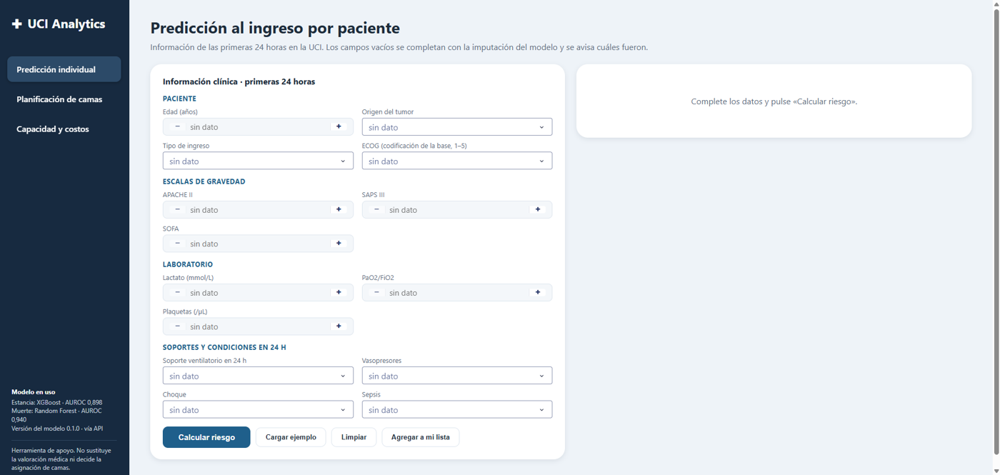
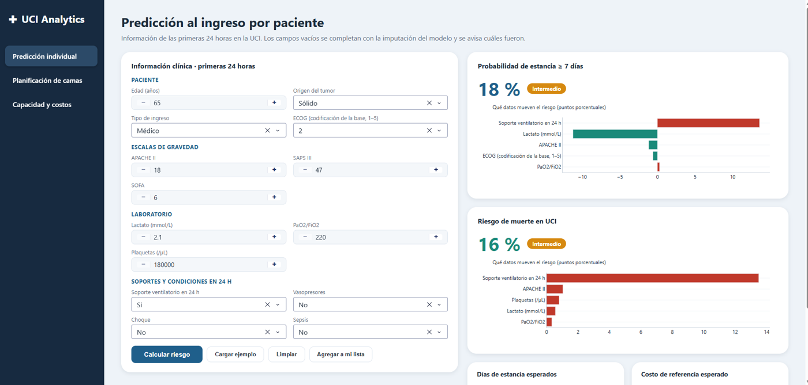
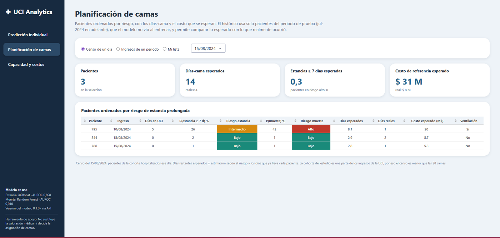
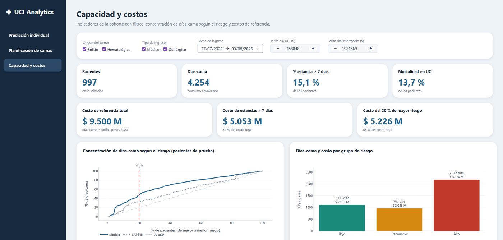

# Manual de usuario del tablero UCI Analytics

## Acceso

El tablero está publicado en https://tablero-production-fa43181f.up.railway.app y se abre desde cualquier navegador, sin usuario ni contraseña. La API que lo alimenta tiene su documentación interactiva en https://proyectodespliegueg17-production.up.railway.app/docs, donde también es posible enviar un paciente de prueba y ver la respuesta del modelo.

Si la página tarda en cargar la primera vez, basta con esperar unos segundos y recargar: el servicio puede estar inactivo y tarda un momento en responder.

## Propósito y usuarios

El tablero toma la información de las primeras 24 horas de un paciente oncológico en la unidad de cuidado intensivo (UCI) y estima dos probabilidades: la de permanecer siete días o más en la unidad y la de morir durante la estancia. A partir de la primera calcula los días-cama esperados y un costo de referencia. Las probabilidades provienen de dos modelos entrenados con 14 variables: XGBoost para la estancia prolongada y Random Forest para la mortalidad.

Fue pensado para tres tipos de usuario. El médico de la UCI consulta el riesgo de un paciente recién ingresado. Quien coordina las camas revisa qué pacientes ocuparán la unidad por más tiempo. El área administrativa sigue el consumo de días-cama y su costo.

La herramienta apoya la planificación; la valoración clínica y la asignación de camas siguen a cargo del equipo tratante.

## Estructura general

El menú lateral da acceso a tres pantallas: *Predicción individual*, *Planificación de camas* y *Capacidad y costos*. En la parte inferior del menú, el recuadro *Modelo en uso* informa los modelos activos, su AUROC en el conjunto de prueba temporal y la versión del paquete. La leyenda "vía API" confirma que el tablero está recibiendo las predicciones del servicio desplegado. Si en su lugar aparece "No hay conexión con el modelo", la API no está respondiendo; conviene recargar al cabo de un minuto y, si el mensaje persiste, revisar el servicio según el manual de instalación.

## 1. Predicción individual

### Datos de entrada

El formulario agrupa las 14 variables en cuatro bloques. Todas corresponden a las primeras 24 horas en la UCI.

| Bloque | Variable | Valores aceptados |
|---|---|---|
| Paciente | Edad (años) | 18 a 110 |
| | Origen del tumor | Sólido o hematológico |
| | Tipo de ingreso | Médico o quirúrgico |
| | ECOG | 1 a 5, según la codificación de la base del hospital |
| Escalas de gravedad | APACHE II | 0 a 71 |
| | SAPS III | 0 a 217 |
| | SOFA | 0 a 24 |
| Laboratorio | Lactato (mmol/L) | 0 a 30 |
| | PaO2/FiO2 | 20 a 700 |
| | Plaquetas (/µL) | 0 a 2.000.000, escrito como número completo (por ejemplo, 180000) |
| Soportes y condiciones | Soporte ventilatorio | Sí o no |
| | Vasopresores | Sí o no |
| | Choque | Sí o no |
| | Sepsis | Sí o no |

No es obligatorio llenar todos los campos. Los que quedan vacíos se completan con la misma imputación usada en el entrenamiento: vecinos más cercanos para las variables continuas y el valor más frecuente para las categóricas. Debajo del resultado aparece la lista de variables imputadas, de modo que el usuario sabe qué parte de la estimación no proviene de datos del paciente. Un valor por fuera de los rangos de la tabla se trata como faltante. Cuando falta más de la mitad de la información, el tablero no calcula y solicita al menos la edad, las escalas de gravedad y los soportes.

### Acciones disponibles

*Calcular riesgo* envía los datos a la API y presenta el resultado a la derecha. *Cargar ejemplo* llena el formulario con un paciente ficticio (65 años, tumor sólido, ingreso médico, APACHE II de 18 y soporte ventilatorio), útil para una primera exploración. *Limpiar* borra el formulario. *Agregar a mi lista* guarda el paciente para analizarlo después junto con otros en la pantalla de planificación.

### Interpretación del resultado

Cada desenlace se muestra como un porcentaje acompañado de una categoría de riesgo. Las categorías se definieron con la distribución de probabilidades de la cohorte de entrenamiento:

| Categoría | Criterio |
|---|---|
| Bajo | Por debajo de la mediana |
| Intermedio | Entre la mediana y el percentil 80 |
| Alto | Por encima del percentil 80, es decir, el 20 % de pacientes con mayor probabilidad |

El corte del 20 % responde al objetivo del proyecto: identificar al grupo pequeño de pacientes que concentra buena parte de los días-cama.

Bajo cada probabilidad hay un gráfico titulado *Qué datos mueven el riesgo*. Para construirlo, el tablero reemplaza uno a uno los datos del paciente por la mediana de la cohorte y registra cuántos puntos porcentuales cambia la probabilidad. Una barra roja indica que ese dato eleva el riesgo frente a un paciente típico; una verde, que lo reduce. En el ejemplo de la imagen, el soporte ventilatorio aumenta en cerca de 13 puntos la probabilidad de estancia prolongada. Se trata de una aproximación que examina cada variable por separado y no debe leerse como un efecto causal.

Las dos tarjetas inferiores traducen la probabilidad a recursos. Los *días de estancia esperados* resultan de ponderar dos promedios observados en el entrenamiento: si *p* es la probabilidad de estancia prolongada, el valor es *p* veces la estancia media de quienes permanecieron siete días o más, más (1 − *p*) veces la estancia media del resto. El *costo de referencia esperado* multiplica esos días por la tarifa diaria correspondiente: la de UCI adulto cuando el paciente recibió soporte ventilatorio en las primeras 24 horas y la de cuidado intermedio adulto en los demás casos.

## 2. Planificación de camas

Esta pantalla reúne varios pacientes y los ordena de mayor a menor probabilidad de estancia prolongada. En la parte superior se elige el origen de los datos:

| Fuente | Uso |
|---|---|
| Censo de un día | Muestra los pacientes hospitalizados en una fecha y estima los días que le faltan a cada uno. |
| Ingresos de un periodo | Reúne los ingresos de un rango de fechas y compara lo esperado con lo que efectivamente ocurrió. |
| Mi lista | Trabaja con pacientes propios, cargados desde un archivo o agregados desde la predicción individual. |

El censo y los ingresos por periodo se limitan a los pacientes del conjunto de prueba (desde julio de 2024), que el modelo no conoció durante el entrenamiento. Por eso la comparación entre lo esperado y lo observado sirve como validación. La cohorte del estudio es solo una parte de los ingresos de la UCI, así que el censo de un día suele mostrar menos pacientes que las 28 camas de la unidad.

### Indicadores y tabla

Las cuatro tarjetas resumen la selección: número de pacientes, días-cama esperados, estancias prolongadas esperadas (suma de las probabilidades) y costo de referencia esperado en millones de pesos de 2020. En los datos históricos, cada tarjeta muestra debajo el valor real para comparar. En el censo y en *Mi lista*, la tarjeta de estancias prolongadas indica cuántos pacientes están en riesgo alto.

La tabla presenta, por paciente, la fecha de ingreso, los días que lleva en la UCI, la probabilidad y la categoría de riesgo de cada desenlace, los días esperados, los días reales cuando se conocen, el costo esperado y el antecedente de soporte ventilatorio. Cualquier columna se puede ordenar haciendo clic en su encabezado.

En el censo, los días esperados corresponden a los que le faltan al paciente, no a la estancia total. El cálculo tiene en cuenta el tiempo ya transcurrido: quien completa cinco días tiene una probabilidad de llegar a siete mayor que la que tenía al ingresar, y el tablero ajusta la estimación en consecuencia.

### Mi lista

La lista se alimenta de dos maneras: con el botón *Agregar a mi lista* de la pantalla de predicción, o cargando un archivo CSV. Para lo segundo se descarga la plantilla (`plantilla_pacientes_uci.csv`), se diligencia en Excel con una fila por paciente y se sube con *Cargar CSV de pacientes*.

La plantilla tiene una columna `paciente`, pensada para el número de cama o un código interno (nunca el nombre), y una columna por variable con la siguiente codificación:

| Columna | Codificación |
|---|---|
| `age`, `apacheii`, `sapsiii`, `sofa`, `lactate`, `pafi`, `platelet` | Valor numérico, con punto como separador decimal |
| `origin_of_tumor` | 1 = sólido; 0 = hematológico |
| `type_of_admission` | 1 = médico; 2 = quirúrgico |
| `ecog` | 1 a 5 |
| `ventilatory_support`, `vasopressors_use` | 1 = sí; 0 = no |
| `shock`, `sepsis` | 2 = sí; 1 = no |

Las celdas vacías se imputan igual que en el formulario. Un archivo que no conserve las columnas de la plantilla se rechaza con un aviso.

La lista vive únicamente en la pestaña del navegador: no se almacena en ningún servidor y se pierde al cerrarla.

## 3. Capacidad y costos

La tercera pantalla resume la cohorte completa (997 pacientes ingresados entre julio de 2022 y agosto de 2025) o el subconjunto que se defina con los filtros de origen del tumor, tipo de ingreso y fecha de ingreso. Los campos de tarifa diaria de UCI y de cuidado intermedio admiten otros valores, por ejemplo la tarifa vigente de la institución, y los costos se recalculan de inmediato. El cambio se conserva mientras la pestaña permanezca abierta.

Los indicadores superiores muestran el número de pacientes, los días-cama consumidos, la proporción de estancias de siete días o más y la mortalidad en la UCI, todos con datos observados. Los de la segunda fila se refieren al costo de referencia: el total, la parte generada por las estancias prolongadas y la que corresponde al 20 % de pacientes con mayor riesgo según el modelo. En la cohorte completa, ese 20 % reúne el 55 % del costo.

El gráfico de concentración, construido solo con los pacientes de prueba, ordena a los pacientes de mayor a menor riesgo y acumula el porcentaje de días-cama que consumieron. La línea vertical marca el 20 %. Cuanto más alta esté la curva del modelo en ese punto, mayor es la proporción de días-cama que concentra el grupo señalado. Para comparar, el gráfico incluye el ordenamiento por SAPS III y uno aleatorio (la diagonal).

Los demás gráficos muestran los días-cama y el costo por categoría de riesgo, la evolución semestral de ingresos, estancia prolongada y mortalidad, y la fracción del consumo atribuible a pacientes con soporte ventilatorio en las primeras 24 horas.

## Tarifas de referencia

Los costos se basan en el artículo 3 de la Resolución 1068 de 2020 del Ministerio de Salud y Protección Social, que fijó $2.458.848 por día de UCI adulto y $1.921.669 por día de cuidado intermedio adulto (pesos de 2020). Esa resolución reguló la atención de pacientes con COVID-19 bajo la coordinación de los Centros Reguladores de Urgencias y Emergencias (CRUE) y no contempla comorbilidades. En el tablero cumple la función de referencia pública para comparar escenarios; no reproduce los costos reales del hospital.

## Limitaciones

Los modelos se entrenaron con 816 pacientes de un único hospital de cuarto nivel, ingresados hasta junio de 2024, y se evaluaron con 181 pacientes posteriores. Su desempeño puede no trasladarse a otras unidades ni mantenerse si cambian de forma importante las prácticas de atención.

La duración de la estancia depende en parte de decisiones administrativas, como la disponibilidad de camas en hospitalización general o los traslados, que el modelo no observa.

La explicación por variable es una aproximación y no indica causalidad. Los costos, como se señaló, son de referencia.

## Solución de problemas

| Situación | Qué hacer |
|---|---|
| La página demora en abrir | Esperar unos segundos y recargar. |
| El menú indica "No hay conexión con el modelo" | Recargar al cabo de un minuto; si continúa, revisar la API según el manual de instalación. |
| Aparece "Faltan demasiados datos" | Completar al menos la edad, las escalas de gravedad y los soportes. |
| El archivo CSV no carga | Verificar que conserve las columnas de la plantilla y que los decimales usen punto. |
| *Mi lista* quedó vacía | La lista se borra al cerrar la pestaña; es necesario cargar el archivo otra vez. |
